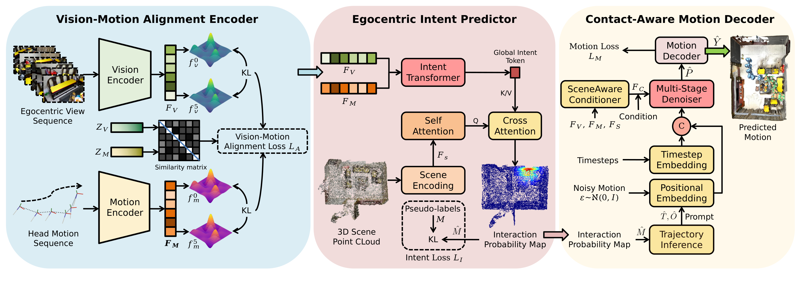
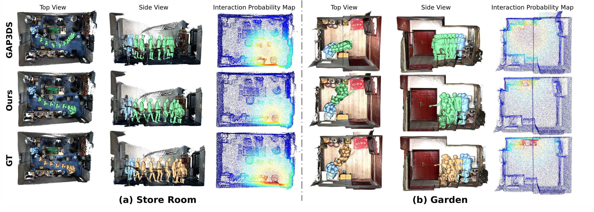
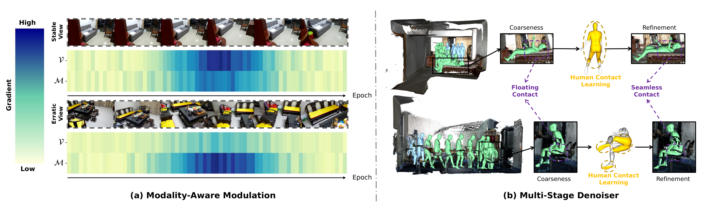

<h1 align="center">EgoHMP: Achieving Precise Human Motion Prediction<br>in 3D Scenes via Egocentric Cues</h1>

<p align="center">
  <strong>NeurIPS 2026</strong> &nbsp;|&nbsp;
  <a href="https://nips.cc/virtual/2026/poster/154301">Conference Page</a>
</p>

<p align="center">
  <strong>Xin Zhao</strong><sup>1</sup>,
  <strong>Pengzhan Zhou</strong><sup>1,*</sup>,
  Ziyi Li<sup>1</sup>,
  Riheng Jia<sup>2</sup>,
  Zhida Qin<sup>3</sup>,
  Yu Liu<sup>4</sup>
</p>

<p align="center">
  <sup>1</sup>Chongqing University &nbsp;&nbsp;
  <sup>2</sup>Zhejiang Normal University &nbsp;&nbsp;
  <sup>3</sup>Beijing Institute of Technology &nbsp;&nbsp;
  <sup>4</sup>The Hong Kong Polytechnic University
  <br>
  <sup>*</sup>Corresponding author: <a href="mailto:pzzhou@cqu.edu.cn">pzzhou@cqu.edu.cn</a>
</p>

---

## 🔍 Overview

**EgoHMP** is a framework for **3D scene-aware human motion prediction** from **egocentric video, head motion, and 3D scene geometry**. Unlike approaches that use gaze as a proxy for human intention, EgoHMP infers interaction intent by combining the semantic context of first-person observations with the anticipatory spatial cues of head motion. It then predicts an interaction region in the 3D scene and uses this intent to guide the generation of accurate, physically plausible future motions.

<p align="center">
  
</p>
<p align="center"><em>Figure 1. Overview of EgoHMP: predicting future human motions through egocentric interaction-intent understanding.</em></p>

## 💡 Motivation

Accurately predicting human motion in 3D environments requires knowing **where a person intends to interact** and **how their body will move**. Existing methods face three challenges:

1. **Unreliable gaze-based intent inference.** Gaze can be ambiguous or noisy, and accurate 3D gaze acquisition requires specialized eye-tracking hardware.
2. **Difficult grounding of egocentric intent in 3D scenes.** First-person video conveys rich semantics, while head motion supplies complementary spatial and movement cues; fusing them into reliable 3D interaction predictions remains challenging.
3. **Limited physical plausibility in predicted motions.** Joint optimization of global trajectories and local body poses can cause conflicts, while insufficient contact modeling leads to floating, sliding, and penetration artifacts.

**Key insight:** Egocentric visual observations and head motion provide complementary cues for inferring **interaction intent without gaze signals**. Predicting interaction locations and contact-aware body motion can connect intent understanding to realistic motion execution.

## ✨ Highlights

- **Gaze-free interaction intent:** Jointly exploits egocentric appearance and head-motion cues rather than relying on eye tracking.
- **3D scene grounding:** Predicts a point-wise **interaction probability map** over a 3D scene point cloud.
- **Trajectory-guided generation:** Uses a predicted global trajectory as a **self-prompt** to separate global motion planning from local pose generation.
- **Contact-aware refinement:** Learns human-body contact regions to improve motion consistency and mitigate geometric artifacts.

## 🧠 Method

<p align="center">
  
</p>
<p align="center"><em>Figure 2. EgoHMP pipeline: Vision-Motion Alignment Encoder → Egocentric Intent Predictor → Contact-Aware Motion Decoder.</em></p>

EgoHMP consists of **three main components**:

### 1. Vision-Motion Alignment Encoder

Encodes egocentric video with a DINOv2-based vision branch and head-motion sequences with a motion branch. A **vision-motion alignment loss** promotes consistent local variations and aligned global representations across the two modalities.

### 2. Egocentric Intent Predictor

Integrates visual and head-motion features using an **Intent Transformer**. A **modality-aware modulation mechanism** adjusts the contribution of less reliable cues during learning. Scene-point features then attend to the inferred intent to produce a **3D interaction probability map** indicating likely human-scene interaction regions.

### 3. Contact-Aware Motion Decoder

Predicts an intent-guided **global trajectory** and uses it as a self-prompt for diffusion-based local pose synthesis. A **scene-aware conditioner** provides relevant local geometry, while a **multi-stage denoiser** learns human contact regions and refines body poses. A **GCN-based motion decoder** generates the final 3D motion sequence.

### Inputs and outputs

| Component | Description |
|:--|:--|
| **Egocentric video** | Historical first-person RGB frames |
| **Head motion** | Historical 3D head translation and orientation |
| **3D scene** | RGB-colored 3D point cloud |
| **Output** | Future global human trajectory and 3D body motion |

The paper uses **6 observed frames** to predict **10 future frames** in its main prediction setup.

## 📊 Experimental Results

We evaluate EgoHMP on **GIMO**, **GTA-IM**, and **Ego-Exo4D**, covering motion accuracy, interaction-intent localization, and physical plausibility.

### GIMO and GTA-IM

| Dataset | Method | Traj-Path ↓ (mm) | MPJPE-Path ↓ (mm) | TDE@1 ↓ (mm) | Penetration ↓ (%) |
|:--|:--|--:|--:|--:|--:|
| **GIMO** | GAP3DS | 575 | 141.2 | 210.5 | 0.95 |
| **GIMO** | **EgoHMP (Ours)** | **481** | **114.9** | **161.3** | **0.81** |
| **GTA-IM** | GAP3DS | 610 | 155.0 | 235.4 | 1.12 |
| **GTA-IM** | **EgoHMP (Ours)** | **522** | **129.6** | **182.5** | **0.91** |

**Metric definitions:** Traj-Path is average global trajectory error; MPJPE-Path is average joint position error over the predicted sequence; TDE@1 is top-1 interaction target localization error; and Penetration measures the percentage of body-scene intersection.

### Ego-Exo4D

| Method | Scene-aware evaluation | MPJPE-Path ↓ (mm) | MPJPE-End ↓ (mm) |
|:--|:--:|--:|--:|
| EgoCast | ✓ | 153.6 | 193.7 |
| EgoAllo | ✓ | 144.7 | 178.4 |
| UniEgoMotion | ✓ | 158.5 | 192.5 |
| **EgoHMP (Ours)** | **✓** | **128.6** | **157.0** |

> **Evaluation note:** In this scene-aware comparison, competing egocentric methods are aligned with **ground-truth global trajectories**, while EgoHMP uses its **own predicted trajectory**, as described in the paper. The results should be interpreted with this protocol in mind.

## 🎞️ Qualitative Comparisons

<p align="center">
  
</p>
<p align="center"><em>Figure 3. Qualitative comparisons with GAP3DS in the Store Room and Garden scenes. Blue, green, and tan meshes depict historical, predicted, and ground-truth motion, respectively.</em></p>

EgoHMP produces more localized interaction regions and more consistent future movements in the visualized scenes, compared with the gaze-based baseline GAP3DS.

## 🧪 Ablation Studies

<p align="center">
  
</p>
<p align="center"><em>Figure 4. (Left) Modality-aware gradient modulation under stable and erratic egocentric views. (Right) Contact-aware pose refinement alleviates floating contacts.</em></p>

Selected GIMO ablations demonstrate the impact of egocentric inputs, reliability-aware modality fusion, and trajectory self-prompting:

| Setting | Traj-Path ↓ (mm) | MPJPE-Path ↓ (mm) |
|:--|--:|--:|
| Without egocentric visual input | 676 | 168.9 |
| Replace egocentric vision with gaze | 589 | 145.9 |
| Without modality-aware modulation | 501 | 130.4 |
| Without trajectory self-prompt | 612 | 150.4 |
| **Full EgoHMP** | **481** | **114.9** |

## 🗂️ Datasets

The paper reports experiments on the following datasets:

- **GIMO:** Egocentric, scene-aware 3D human motion prediction with reconstructed 3D environments.
- **GTA-IM:** Synthetic human motions and interactions in indoor environments.
- **Ego-Exo4D:** Synchronized first-person and third-person video with 3D human-pose and scene information.

Please consult the respective dataset providers for access requirements, licenses, and permitted uses.

## ⚙️ Code and Reproducibility

This README documents the **paper's method, figures, and reported results**. Runnable training/inference scripts, environment specifications, and pretrained checkpoints were **not included in the supplied materials**, so commands and download links are not listed here.

<!-- Maintainer TODO: Add setup, dataset-preprocessing, training, evaluation and inference instructions after the corresponding code and model artifacts are available. -->

## 📝 Citation

If you find **EgoHMP** useful in your research, please cite:

```bibtex
@inproceedings{zhao2026egohmp,
  title     = {EgoHMP: Achieving Precise Human Motion Prediction in 3D Scenes via Egocentric Cues},
  author    = {Zhao, Xin and Zhou, Pengzhan and Li, Ziyi and Jia, Riheng and Qin, Zhida and Liu, Yu},
  booktitle = {Advances in Neural Information Processing Systems},
  year      = {2026}
}
```

## 🙏 Acknowledgments

This work was supported by the **National Natural Science Foundation of China** under Grants **62672066**, **62272417**, and **62672037**.
