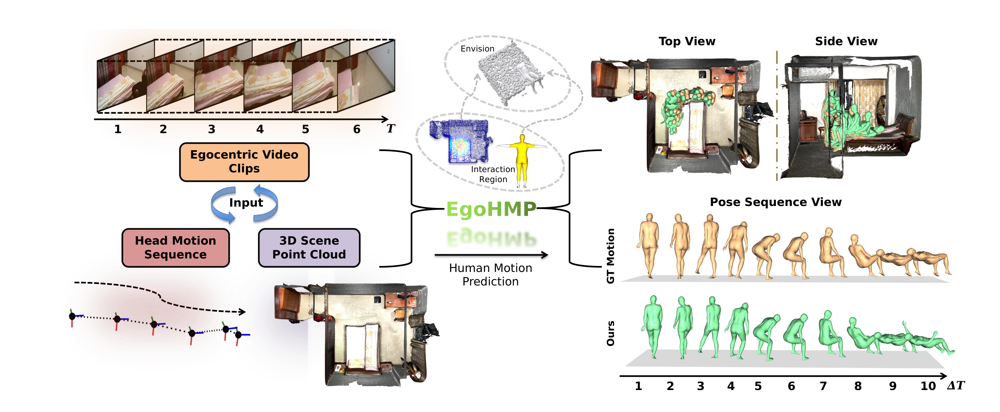

<h1 align="center">EgoHMP: Achieving Precise Human Motion Prediction in 3D Scenes via Egocentric Cues</h1>

<p align="center">
  <strong>NeurIPS 2026</strong> &nbsp;|&nbsp;
  <a href="https://nips.cc/virtual/2026/poster/154301">Conference Page</a>
</p>

<p align="center">
  Xin Zhao</strong><sup>1</sup>,
  Pengzhan Zhou</strong><sup>1,*</sup>,
  Ziyi Li<sup>1</sup>,
  Riheng Jia<sup>2</sup>,
  Zhida Qin<sup>3</sup>,
  Yu Liu<sup>4</sup>
</p>

<p align="center">
  <sup>1</sup>Chongqing University &nbsp;&nbsp;
  <sup>2</sup>Zhejiang Normal University &nbsp;&nbsp;
  <sup>3</sup>Beijing Institute of Technology &nbsp;&nbsp;
  <sup>4</sup>The Hong Kong Polytechnic University
  <br>
</p>

---

## 🔍 Overview

**EgoHMP** is a framework for **3D scene-aware human motion prediction** from **egocentric video, head motion, and 3D scene geometry**. Unlike approaches that use gaze as a proxy for human intention, EgoHMP infers interaction intent by combining the semantic context of first-person observations with the anticipatory spatial cues of head motion. It then predicts an interaction region in the 3D scene and uses this intent to guide the generation of accurate, physically plausible future motions.

<p align="center">
  
</p>

## 💡 Motivation

Accurately predicting human motion in 3D environments requires knowing **where a person intends to interact** and **how their body will move**. Existing methods face three challenges:

1. **Unreliable gaze-based intent inference.** Gaze can be ambiguous or noisy, and accurate 3D gaze acquisition requires specialized eye-tracking hardware.
2. **Difficult grounding of egocentric intent in 3D scenes.** First-person video conveys rich semantics, while head motion supplies complementary spatial and movement cues; fusing them into reliable 3D interaction predictions remains challenging.
3. **Limited physical plausibility in predicted motions.** Joint optimization of global trajectories and local body poses can cause conflicts, while insufficient contact modeling leads to floating, sliding, and penetration artifacts.

## ✨ Highlights

- **Gaze-free interaction intent:** Jointly exploits egocentric appearance and head-motion cues rather than relying on eye tracking.
- **3D scene grounding:** Predicts a point-wise **interaction probability map** over a 3D scene point cloud.
- **Trajectory-guided generation:** Uses a predicted global trajectory as a **self-prompt** to separate global motion planning from local pose generation.
- **Contact-aware refinement:** Learns human-body contact regions to improve motion consistency and mitigate geometric artifacts.

## 🧠 Inputs and outputs

| Component | Description |
|:--|:--|
| **Egocentric video** | Historical egocentric RGB frames |
| **Head motion** | Historical 3D head translation and orientation |
| **3D scene** | 3D point cloud |
| **Output** | Future 3D human motion |

We use **6 observed frames** to predict **10 future frames** in its main prediction setup.

## 🗂️ Datasets

- **GIMO** 
- **GTA-IM** 
- **Ego-Exo4D**

Please consult the respective dataset providers for access requirements, licenses, and permitted uses.

## ⚙️ Installation and Usage
### 1. Environment Setup

An NVIDIA GPU and a CUDA-enabled PyTorch installation are recommended. The code includes CUDA autocasting and custom PointNet++ operations. Python **3.10** is a reasonable starting point.

```bash
conda create -n egohmp python=3.10 -y
conda activate egohmp

# Install a matching PyTorch + torchvision build for your CUDA setup first.
# See: https://pytorch.org/get-started/locally/

pip install requirements.txt
python train.py
```

The scene encoder additionally requires a **CUDA-compatible PointNet++ installation**. The source file references [Pointnet2_PyTorch](https://github.com/erikwijmans/Pointnet2_PyTorch); follow the selected implementation's build instructions and verify its compatibility with your CUDA/PyTorch versions.

### 2. Dataset Preparation

Training script use the GIMO directory by default (`./GIMO`). Download the dataset from its provider and prepare it according to its license and access requirements.

The paths read by the source code are summarized below (illustrative `<...>` names represent data-dependent directories and filenames):

```text
GIMO/
├── dataset.csv
├── <scene>/
│   ├── scene_obj/
│   │   └── transform_norm.txt
│   └── <sequence_path>/
│       ├── PV/                         
│       ├── smplx_local/                
│       └── transform_info.json        
├── Cache_6F_FPS2/
│   └── train/
│       ├── fv_full.pth                 
│       └── motion_full.pth             
├── offline_data_full/
│   └── <sample_id>.pt                  
├── offline_sdf_only/
│   └── <sample_id>.pt                  
└── offline_affordance_gt/
    └── <sample_id>_affordance.pt       
```


## 📝 Citation

If you find **EgoHMP** useful in your research, please cite:

```bibtex

```

